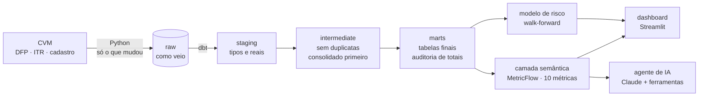

# Next Step SP

[](https://github.com/MRC888/Next-step-SP/actions/workflows/qualidade.yml)

**Plataforma de dados financeiros ponta a ponta com os balanços públicos das empresas da bolsa brasileira.**
Do arquivo bruto da CVM a métricas confiáveis, um painel interativo, um agente de IA que responde em português
e um modelo que aponta risco de dificuldade financeira.

> Os balanços de toda empresa da bolsa são públicos. Quase ninguém consegue usar: são milhões de linhas em códigos
> contábeis, com duplicatas, escalas diferentes, versões corrigidas e até erros na fonte. Este projeto transforma
> isso em respostas, com cada número auditável até a linha original.

## O que o projeto entrega

| Camada | O que faz | Resultado (testado) |
|---|---|---|
| **Ingestão** (Python) | Baixa DFP, ITR e cadastro da CVM; só o que mudou | 35,2 mi de linhas · 1ª carga 3min22s · recarga sem mudanças 2 s |
| **Modelagem** (dbt) | raw → staging → intermediate → marts, com testes | DFP + ITR: 11,2 mi linhas limpas em ~4 min · auditoria de totais |
| **Camada semântica** (MetricFlow) | 10 métricas com regra escrita uma vez | Conferência independente contra o raw: **30/30** |
| **Modelo de risco** (scikit-learn) | Dificuldade financeira em até 24 meses | AUC 0,69 [0,62–0,76] · precisão média 4,5× o acaso · Z'' de Altman: 0,66 |
| **Dashboard** (Streamlit + Plotly) | Empresa × pares × setor, ranking, mapa de risco, chat | Interativo, com filtros, detalhe por clique e download |
| **Agente de IA** (Claude) | Perguntas em português; números só via camada semântica | Prova de 20 perguntas com gabarito (ver `agent/avaliacao`) |

## Arquitetura



Princípios:
- **Dado bruto imutável.** O `raw` guarda tudo como veio; a limpeza pode ser refeita sem baixar de novo.
- **Uma regra por métrica.** Painel, agente e consultas usam a mesma definição (MetricFlow).
- **Auditoria em vez de confiança cega.** Cada total publicado é conferido com a soma das contas filhas; o que
  diverge fica marcado e sai das métricas.
- **Sem ver o futuro.** O modelo só usa balanços já públicos (`dt_entrega`) e é avaliado ano a ano.
- **A IA não calcula.** O agente escolhe a consulta; o número vem da camada semântica.

## Como rodar

Pré-requisitos: macOS ou Windows, Python 3.13, Docker Desktop.

```sh
make setup        # banco em Docker, ambiente Python, bibliotecas
make pipeline     # ingestão → modelagem (dbt) → conferência das métricas → modelo de risco
make dashboard    # abre o painel em http://localhost:8501
make agente P="Qual a alíquota efetiva de IR e CSLL da Ambev em 2025?"
```

Outros comandos: `make` (lista tudo), `make testes`, `make lint`, `make docs` (linhagem do dbt),
`make modelagem-dfp` (só os anuais, mais rápido). Opcional: `make agendar` agenda o pipeline toda segunda às 7h
(launchd); vem desativado.

O agente precisa de `ANTHROPIC_API_KEY` no `.env` (nunca vai para o Git).

## Estrutura

| Pasta | Conteúdo |
|---|---|
| `ingestion/` | `cvm.py`: download incremental (Last-Modified + SHA-256) e carga via `COPY`, uma transação por arquivo |
| `modeling/` | Projeto dbt: modelos, testes, `seeds/excecoes_conhecidas.csv`, camada semântica em `models/semantic/` |
| `agent/` | Ferramentas (`ferramentas.py`), agente (`agente.py`) e a prova com gabarito (`avaliacao/`) |
| `ml/` | Modelo de risco (`treinar.py`) e métricas da avaliação (`resultados/metricas.json`) |
| `dashboard/` | Painel em Streamlit (`app.py`) e camada de dados com cache (`dados.py`) |
| `scripts/` | Conferência das métricas, checagem do ambiente e agendamento |
| `tests/` | Testes automáticos (pytest); os que precisam do banco são pulados no CI |
| `posts-link/` | Textos e imagens dos posts do LinkedIn sobre o processo |

## Qualidade

- **Lint:** Ruff (Python) e SQLFluff (SQL) no pre-commit e no CI.
- **Testes do dbt:** grão único, não nulos, valores aceitos, relações, balanço que fecha e totais conferidos.
- **Testes em Python:** corretor da prova, defesa contra injeção nas ferramentas, métricas do modelo, integração com o banco.
- **CI:** GitHub Actions roda pre-commit, `dbt parse` e pytest a cada push.

## Achados nos dados (documentados)

- A CVM publica **linhas duplicadas** e **dois envios com a mesma versão** de alguns documentos.
- **Itapebi 2021:** total do passivo publicado sem o patrimônio líquido (diferença de R$ 370 mi).
- **Vale 2022:** custo lançado com sinal trocado. Por isso a regra é conferir total e partes, não confiar num só.
- O **nome da empresa** nos documentos é o atual, não o histórico (a DFP 2011 da Americanas já diz "em recuperação judicial").

## Limites

- Bancos e seguradoras ficam fora das métricas (outro plano de contas).
- O cadastro da CVM mostra só a situação atual; o modelo de risco aprende com 50 empresas com evento.
- A nota de risco é relativa (percentil), não uma probabilidade calibrada. Não é recomendação de investimento.

## Dados

Portal de Dados Abertos da CVM (licença ODbL): DFP, ITR e cadastro de companhias abertas.

---
Feito por Marcelo Santos.
