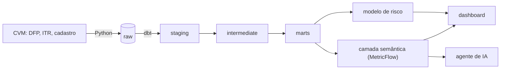

# Next Step SP — Guia de estudo

Relatório para estudar o projeto inteiro e saber onde mexer no futuro. Cada etapa responde: **o que é**, **por que foi feito assim**, **como funciona** (com os arquivos), **o que foi testado**, **como mudar** e **o que perguntariam numa entrevista**.

Nota de decisões e histórico: a nota do projeto no Obsidian. Posts: `posts-link/README.md`.

## Sumário
1. Visão geral
2. Ambiente
3. Base de dados (CVM)
4. Ingestão
5. Modelagem (dbt)
6. Qualidade do código
7. Camada semântica (MetricFlow)
8. Agente de IA
9. Machine learning (risco)
10. Dashboard
11. Automação e comandos
12. Divulgação (posts)
13. Mapa de arquivos
14. Receitas para mudar o projeto
15. Glossário
16. Perguntas de entrevista
17. Limites e próximos passos

---

## 1. Visão geral

**Problema.** Os balanços de toda empresa da bolsa são públicos (CVM), mas vêm em milhões de linhas, em códigos contábeis, com duplicatas, escalas diferentes, versões corrigidas e até erros. Responder "essa empresa vai bem?" exige horas de planilha.

**Solução.** Uma plataforma ponta a ponta: o dado chega sozinho, é limpo e conferido, cada métrica tem uma regra escrita uma vez, e três "consumidores" usam essas regras: um painel, um agente de IA e um modelo de risco.

**Stack.**
| Peça | Ferramenta | Por quê |
|---|---|---|
| Banco | PostgreSQL 17 em Docker (porta 5433) | Banco relacional padrão; Docker isola e recria igual em qualquer máquina |
| Ingestão | Python (requests, psycopg) | Controle total do download incremental e da carga |
| Transformação | dbt Core 1.11 | Padrão de mercado para modelagem em SQL com testes e documentação |
| Métricas | MetricFlow 0.15 (dbt Semantic Layer, Apache 2.0) | Regra de cada métrica definida uma vez, compilada em SQL |
| ML | scikit-learn | Biblioteca padrão; modelos simples e explicáveis |
| IA | Claude Opus 5.5 (SDK oficial da Anthropic) | Uso de ferramentas (tool use) para não inventar números |
| Painel | Streamlit + Plotly | Python puro, interativo, roda no Mac (Power BI não roda) |
| Qualidade | Ruff, SQLFluff, pre-commit, pytest, GitHub Actions | Padrão de mercado para código limpo e testado |

**Números principais (testados em 30/10/2026).** Agente de IA: 20/20 na prova · 35,2 mi de linhas na origem · 11,2 mi linhas limpas (DFP + ITR) · 10.037 balanços anuais de empresas comuns · 10 métricas conferidas 30/30 · modelo de risco com AUC 0,69 (Altman 0,66) e precisão 4,5× o acaso · 35 testes em Python · CI verde.

---

## 2. Ambiente

**O que é.** Tudo o que o projeto precisa para rodar: Docker (banco), Python (ambiente virtual), VS Code, DBeaver, Git.

**Como funciona.**
- `docker-compose.yml`: sobe o PostgreSQL 17 na porta **5433** (a 5432 é do PostgreSQL 18 instalado no Mac). O nome do projeto Docker é fixo (`projetosp-dataadvanced`): é dele que sai o nome do volume com os dados; renomear a pasta sem isso criaria um banco vazio.
- `setup.sh`: cria o `.env` com senha aleatória, o venv em `~/.venvs/projeto-sp-data` (fora do OneDrive, para não sincronizar bibliotecas), instala `requirements.txt`, sobe o banco e roda `scripts/check_env.py`.
- `.env`: senhas e a chave da API. **Nunca** vai para o Git (`.gitignore`).
- `~/.pgpass`: senha do banco para o DBeaver, o dbt e o Python sem digitar.

**Decisões.** Venv e dados pesados fora do OneDrive; projeto roda só no Mac (o PC é reserva); push pelo `gh` com permissão `workflow` (necessária para o CI).

**Perguntas de entrevista.** *Por que Docker?* Isola o banco, recria igual em qualquer máquina e não mexe no PostgreSQL do sistema. *Onde ficam os segredos?* No `.env` (ignorado pelo Git) e no `~/.pgpass`.

---

## 3. Base de dados (CVM)

**O que é.** Portal de Dados Abertos da CVM (licença ODbL):
- **DFP**: balanço anual (desde 2010). **ITR**: trimestral (desde 2011). **Cadastro**: situação de cada companhia.
- Cada ZIP anual traz um CSV por demonstração: BPA (ativo), BPP (passivo + PL), DRE (resultado), DFC (caixa, métodos direto e indireto), DMPL, DVA etc., cada uma em **consolidado** (grupo) e **individual** (controladora).
- Formato "longo": uma linha por conta (`CD_CONTA`, ex.: 3.01 receita, 2.03 PL), com `ESCALA_MOEDA` (MIL ou UNIDADE), `ORDEM_EXERC` (ÚLTIMO = ano atual; PENÚLTIMO = comparação) e `VERSAO` (sobe quando a empresa reenvia).

**Por que CVM e não IF.data.** Dinâmica (atualização semanal), multissetorial (melhor para ML), e tem um rótulo possível de risco (situação do emissor). IF.data é só bancos, trimestral com atraso.

**Armadilhas descobertas.**
- Linhas duplicadas na fonte; dois envios com a mesma versão.
- Lucro por ação (3.99) vem em R$ por ação mesmo com escala MIL.
- Totais errados (Itapebi 2021), sinais trocados (Vale 2022), filhas zeradas (CESP 2022, G2D 2021), ITR incompletos (6 casos).
- O **nome da empresa é o atual** em todos os documentos antigos (não serve como data histórica).
- O cadastro guarda só a **situação atual**.

---

## 4. Ingestão — `ingestion/cvm.py`

**O que é.** O "encanamento": leva o dado da CVM até o schema `raw` do banco.

**Como funciona (passo a passo do código).**
1. `listar_zips()`: lê a página da CVM e descobre os anos disponíveis.
2. `baixar_se_mudou()`: pergunta ao servidor a data do arquivo (**HEAD**, `Last-Modified`). Se não mudou, pula. Se mudou, baixa para um arquivo temporário e só troca no fim (download nunca fica pela metade). Calcula o **SHA-256** (impressão digital): se o conteúdo é igual, não recarrega.
3. `carregar_zip()`: para cada CSV do ZIP, apaga as linhas antigas daquele arquivo e insere as novas com **COPY** (o jeito mais rápido de inserir em massa no PostgreSQL), **numa transação só** (ou entra tudo, ou nada muda).
4. `garantir_tabela()`: cria a tabela com tudo como texto e acrescenta colunas novas se a CVM mudar o layout.
5. `registrar()`: grava em `raw._controle_cargas` (arquivo, data, hash, linhas).
6. Cadastro: cada versão nova é **acumulada** (vira histórico), e os dados pessoais dos responsáveis ficam de fora (LGPD).

**Resultados (testados).** 34 arquivos, 35,2 mi de linhas, 3min22s; segunda execução: 2 s, tudo "sem mudança"; contagem no banco igual à dos arquivos.

**Conceito-chave: idempotência.** Rodar 1 ou 100 vezes dá o mesmo resultado. É o que permite agendar sem medo.

**Como mudar.** Incluir DMPL/DVA: adicionar em `DEMONSTRACOES`. Nova fonte (ex.: SGS do Banco Central, Selic/IPCA): novo script em `ingestion/` no mesmo padrão (baixa → raw → controle).

---

## 5. Modelagem (dbt) — `modeling/`

**O que é.** A limpeza, em camadas de SQL testáveis. O padrão é o do guia oficial da dbt Labs (staging → intermediate → marts), equivalente à arquitetura medallion (bronze/prata/ouro) da Databricks.

| Camada | Modelos | O que faz |
|---|---|---|
| **staging** (views) | `stg_cvm__demonstracoes`, `stg_cvm__documentos`, `stg_cvm__cadastro` | Junta as tabelas do raw, tipa datas e números, converte tudo para reais (exceto lucro por ação) |
| **intermediate** | `int_demonstracoes__deduplicadas` (tabela), `int_demonstracoes__escopo_preferido` | Só o exercício atual; remove duplicatas (fica a versão mais recente); escolhe consolidado quando existe |
| **marts** (tabelas) | `fct_demonstracoes`, `dim_empresa`, `fct_contas_anuais`, `fct_risco_features` | Tabela final de contas; empresas; base das métricas (com auditoria); base do modelo de risco |
| **seeds** | `excecoes_conhecidas.csv` | Erros da fonte já investigados, com motivo e evidência |
| **semantic** | `metricflow_time_spine`, `_semantic.yml` | Calendário e regras das métricas (seção 7) |

**Funil (DFP, testado).** 8.613.133 linhas → 4.325.790 (sem a coluna de comparação) → 4.306.330 (sem duplicatas e versões antigas) → 2.710.385 (sem contagem dupla grupo/controladora). Com ITR: 11,2 mi linhas finais.

**Decisões e por quê.**
- **Fatia fina primeiro** (DFP antes do ITR): passar um recorte pequeno por todas as etapas antes de ampliar (walking skeleton / thin slice, Thoughtworks).
- **`deduplicadas` como tabela com índice**, não view: a função de janela é o passo mais pesado e era recalculada a cada leitura. Foi a causa da queda de 70 min; hoje o build completo leva ~4 min.
- **Documento duplicado na CVM**: fica a entrega mais tardia (escolha conservadora para o ML).
- **Exceções em seed**: o teste continua vigiando tudo, exceto casos investigados.

**Testes do dbt.** Grão único; não nulos; valores aceitos; relação com o cadastro (aviso: 23 CNPJs fora do cadastro); `balanco_fecha` (ativo = passivo + PL); `totais_conferem` (11 documentos inconsistentes, fora das métricas); `dt_entrega` não nula (protege o ML).

**Como mudar.** Nova coluna numa tabela final: editar o `.sql` em `marts/`, documentar no `_marts.yml`, rodar `make modelagem`. Rodar só a DFP: `make modelagem-dfp`.

**Perguntas de entrevista.** *Por que camadas?* Cada uma tem uma responsabilidade; um erro é localizado e corrigido num lugar só. *View ou tabela?* View não ocupa disco e é sempre atual; tabela é rápida para ler. Passo pesado lido várias vezes vira tabela. *Como você garante qualidade?* Testes no dbt a cada build, auditoria de totais e exceções documentadas.

---

## 6. Qualidade do código

| Ferramenta | O que faz | Onde |
|---|---|---|
| **Ruff** | Lint e formatação de Python | `pyproject.toml` |
| **SQLFluff** | Lint de SQL (templater jinja, entende `ref()`, `source()` e as macros do projeto) | `.sqlfluff` |
| **pre-commit** | Roda os dois e checagens básicas antes de cada commit | `.pre-commit-config.yaml` |
| **pytest** | 35 testes: corretor da prova, defesa contra injeção, métricas do ML, integração com o banco | `tests/` |
| **GitHub Actions (CI)** | A cada push: pre-commit, `dbt parse` e pytest (testes de banco são pulados) | `.github/workflows/qualidade.yml` |

**Erros reais que essas ferramentas pegaram.** `day` como nome de coluna (palavra reservada); arquivo de 806 KB entrando no Git; o corretor lendo "mil" como "milhões" (o teste pegou).

---

## 7. Camada semântica (MetricFlow) — `modeling/models/semantic/_semantic.yml`

**O que é.** Um arquivo onde cada métrica tem nome, explicação e fórmula, escritos uma vez. O MetricFlow transforma o pedido ("margem líquida por ano da WEG") em SQL. Painel, agente e consultas usam a mesma regra.

**Conceitos.**
- **Semantic model**: diz quais colunas de uma tabela são entidades, dimensões e medidas.
- **Entidade**: a "chave" (ex.: `documento` = empresa + ano; `empresa` = CNPJ). Permite juntar tabelas.
- **Dimensão**: forma de agrupar (ano, empresa, setor).
- **Medida**: número que se soma (receita, lucro).
- **Métrica simples**: uma medida com filtro. **Métrica de razão**: numerador ÷ denominador (soma ÷ soma).

**Base: `fct_contas_anuais`.** Uma linha por empresa e ano (DFP, empresas comerciais e industriais). Regra de auditoria: valor oficial = total que a empresa publicou; cada total é comparado com a soma das contas filhas; se divergir além da tolerância (R$ 1.000 ou 0,1%, macro `diverge`), o documento fica `dados_consistentes = false` e sai das métricas (11 de 10.037).

**As 10 métricas.**
| Métrica | Fórmula | Contas |
|---|---|---|
| Receita líquida | 3.01 | — |
| Lucro bruto | 3.03 | — |
| Lucro líquido | 3.11 | — |
| Margem bruta | lucro bruto ÷ receita | 3.03 / 3.01 |
| Margem operacional (EBIT) | resultado operacional ÷ receita | 3.05 / 3.01 |
| Margem líquida | lucro líquido ÷ receita | 3.11 / 3.01 |
| **Alíquota efetiva de IR e CSLL** | −IR/CSLL ÷ lucro antes dos tributos, **só com lucro positivo** | −3.08 / 3.07 |
| Liquidez corrente | ativo circulante ÷ passivo circulante | 1.01 / 2.01 |
| Dívida bruta / PL | (2.01.04 + 2.02.01) ÷ 2.03 | — |
| ROE | lucro líquido ÷ PL do fim do ano | 3.11 / 2.03 |

**Regra fiscal (sua área).** A alíquota nominal no lucro real é 34% (IR 15% + adicional 10% + CSLL 9%); a efetiva difere por JCP, incentivos, prejuízo fiscal e diferenças permanentes. Com prejuízo antes dos tributos, a razão de dois negativos dá um número sem sentido (Magazine Luiza 2023 daria 52,6%), então a métrica fica vazia. Exemplos: WEG 2025 = 16,8%; Ambev 2025 = 17,7%.

**Conferência independente.** `scripts/conferir_metricas.py` (ou `make conferir`) lê o raw direto, calcula em Python e compara com o MetricFlow: **30/30** (WEG 2025, Ambev 2025, Magazine Luiza 2023).

**Como adicionar uma métrica.** 1) Garanta a coluna em `fct_contas_anuais.sql`. 2) Em `_semantic.yml`, crie a medida e a métrica (com `filter` de `dados_consistentes`). 3) `cd modeling && dbt parse && mf validate-configs`. 4) Acrescente o cálculo à mão em `conferir_metricas.py`. 5) `make conferir`.

---

## 8. Agente de IA — `agent/`

**O que é.** Você pergunta em português; o Claude escolhe qual consulta fazer; o **número vem da camada semântica**, nunca da memória da IA.

**Como funciona.**
- `ferramentas.py`: 4 funções Python, testáveis sem IA: `listar_metricas`, `buscar_empresas` (nome oficial), `listar_setores`, `consultar_metricas` (chama `mf query`; filtros de empresa, setor, anos, receita mínima; ranking).
- **Segurança**: métricas e anos validados; nomes passam por `_literal` (dobra aspas e rejeita caracteres de controle e chaves), contra **injeção**.
- `agente.py`: **Tool Runner** do SDK oficial (o loop "IA pede ferramenta → Python executa → IA continua" é automático). Modelo `claude-opus-5-5`, esforço `medium`, fallback de recusa ligado. O **system prompt** (instruções fixas) proíbe calcular números e manda citar a regra e a fonte.
- `avaliacao/`: prova de 20 perguntas (12 números, 4 rankings, 4 pegadinhas: banco, alíquota com prejuízo, empresa inexistente, documento inconsistente) com **correção determinística** (lê números no padrão brasileiro). Pronto = ≥18/20 e 4/4 pegadinhas.

**Resultado da prova (30/10/2026, testado):** **20/20 acertos e 4/4 pegadinhas**, em 3min13s, custo total **US$ 1,03** (~US$ 0,05 por pergunta). Nas pegadinhas, o agente explicou que bancos ficam fora das métricas (Itaú), que a alíquota não se aplica com prejuízo (Magazine Luiza 2023), que a empresa não existe na base (Padaria do Zé) e que o ano da Vale 2022 falta por totais inconsistentes. Respostas e ferramentas usadas: `agent/avaliacao/resultado.json`. Rodar de novo: `make avaliar-agente`.

**Perguntas de entrevista.** *Como evitar que a IA invente números?* Ela não calcula: escolhe a consulta, e a regra está na camada semântica; o prompt proíbe estimar; a prova mede. *Como você sabe que ela acerta?* Avaliação com gabarito e pegadinhas, corrigida sem IA.

---

## 9. Machine learning (risco) — `ml/treinar.py` e `fct_risco_features`

**Pergunta de negócio.** Dado o balanço que a empresa acabou de publicar, qual o risco de ela entrar em recuperação judicial, falência ou liquidação nos **24 meses** seguintes?

**Alvo (gabarito).** 1 se o evento (cadastro da CVM, `dt_inicio_situacao_emissor`) acontece depois da entrega e em até 24 meses. Por que 24: com 12 meses sobravam poucos casos.

**Sinais (features).** Os 4 componentes do **Z'' de Altman** (capital de giro/ativo, lucros retidos/ativo, EBIT/ativo, PL/passivo), mais liquidez, dívida/ativo, ROA, margem líquida, crescimento da receita, tamanho, patrimônio negativo e prejuízo.

**Sem vazamento de futuro.** Sinais só do balanço já público (`dt_entrega`); anos em que a empresa já estava em dificuldade saem da base. **Erro achado e corrigido:** o nome da empresa nos documentos é o atual, então filtrar por ele apagava os anos anteriores à crise (61 → 18 casos); o filtro foi desfeito.

**Validação walk-forward.** Para cada ano de teste, o modelo treina só com balanços cujo desfecho já era conhecido antes; as previsões de todos os anos (2013–2024) são juntadas. Usa todos os 50 casos sem ver o futuro.

**Resultados (testados).**
| Régua | AUC [IC 95%] | Precisão média | Acerto no top 10% |
|---|---|---|---|
| **Gradient boosting** | **0,69** [0,62–0,76] | **0,060** (4,5× o acaso) | 34% |
| Z'' de Altman | 0,66 [0,60–0,73] | 0,029 | 28% |
| Teve prejuízo | 0,66 | 0,021 | n/a |
| Patrimônio negativo | 0,63 | 0,025 | n/a |
| Regressão logística | 0,61 | 0,028 | 28% |

Taxa base (acaso): 1,34%. Sinais que mais pesam: PL/passivo, lucros retidos/ativo, ROA, margem líquida.

**Leitura honesta.** Ganho real, mas modesto. Poucos casos e cadastro só com a situação atual. A nota é **relativa** (percentil), não probabilidade calibrada. Uso: alerta para investigar.

**Como mudar.** Horizonte: var `horizonte_risco_meses` (dbt) e `HORIZONTE_MESES` (Python). Novo sinal: coluna em `fct_risco_features.sql` + nome em `SINAIS`. Retreinar: `make risco`.

**Perguntas de entrevista.** *O que é vazamento?* O modelo aprender com informação que não existiria no momento da previsão. *Por que não acurácia?* Com 1,3% de casos, dizer "ninguém quebra" dá 98,7% de acurácia e não serve para nada; precisão média e AUC medem o que importa. *Por que comparar com Altman?* É a referência da literatura; um modelo que não ganha dele não se justifica.

---

## 10. Dashboard — `dashboard/`

**O que é.** Painel interativo em Streamlit + Plotly (`make dashboard`, http://localhost:8501).

| Aba | O que tem |
|---|---|
| Empresa | Cards com minigráfico; comparação com até 3 pares; mediana e quartis do setor; métricas por finalidade (tamanho, rentabilidade, tributos, liquidez e endividamento); tabela e CSV; link compartilhável (`?empresa=`) |
| Ranking | Por métrica, setor e ano, com receita mínima; detalhe por clique ou lista |
| Risco | Indicadores do modelo; mapa modelo × Z'' de Altman; tabela clicável; sinais mais importantes |
| Pergunte à IA | Chat com o agente, perguntas-exemplo e "como a resposta foi montada" |
| Dados e método | Linhagem, qualidade, avaliação do modelo e limites |

**Boas práticas aplicadas.** Cache das consultas (`st.cache_data`); estado guardado entre interações; comparação com mediana e quartis do setor (padrão de análise de pares); uma cor por entidade em ordem fixa, cores de status só para zonas de risco e sempre com rótulo; nenhum gráfico de eixo duplo.

**Como mudar.** Nova métrica no painel: incluir em `GRUPOS` (`dados.py`). Novo gráfico: função em `app.py` usando `d.series()` ou `d.ranking()`.

---

## 11. Automação e comandos

- **Makefile**: `make` lista tudo. Principais: `pipeline` (ingestão → modelagem → conferência → risco), `dashboard`, `agente P="..."`, `avaliar-agente`, `testes`, `lint`, `docs`, `agendar`.
- **Agendamento (opcional, desativado por decisão de Marcelo)**: `make agendar` instalaria um agendamento do **launchd** (agendador do macOS): toda segunda às 7h, `scripts/pipeline_agendado.sh` abre o Docker, espera o banco, rodaria `make pipeline` e gravaria o log em `~/Library/Logs/next-step-sp/`. Foi testado de ponta a ponta (8min39s), mas não está ativo: o projeto é de portfólio e nada roda sozinho. Desfazer: `launchctl unload ~/Library/LaunchAgents/com.nextstepsp.pipeline.plist`.
- **Evolução de mercado**: Dagster ou Airflow (orquestradores com interface e linhagem). Não foram usados porque o banco vive só no Mac; o launchd resolve com menos peças.

---

## 12. Divulgação (posts)

Pasta `posts-link/`. Regras: começar pelo problema em linguagem de leigo; imagem 1080×1350 com a mesma identidade; barra das 9 etapas com o progresso real e "▲ este post"; nada de número não testado.
- Post 1 (ponto de partida), 2 (ingestão), 3 (dado sujo, dado limpo): publicados.
- Post 5 (dá para prever uma crise?): rascunho com imagem.
- Post 4 (perguntando aos balanços): rascunho com o resultado da prova (20/20).
- Post 6 (final, impulsionado): depende do GitHub público e do portfólio.

---

## 13. Mapa de arquivos

| Caminho | O que é |
|---|---|
| `Makefile` | Comandos do projeto |
| `setup.sh`, `docker-compose.yml`, `.env.example` | Ambiente |
| `ingestion/cvm.py` | Ingestão |
| `modeling/models/staging/` | Camada staging |
| `modeling/models/intermediate/` | Deduplicação e escolha do consolidado |
| `modeling/models/marts/` | Tabelas finais e bases de métricas e risco |
| `modeling/models/semantic/_semantic.yml` | Regras das métricas |
| `modeling/seeds/excecoes_conhecidas.csv` | Erros da fonte investigados |
| `modeling/tests/` | Testes de dados |
| `modeling/macros/diverge.sql` | Tolerância da auditoria |
| `scripts/conferir_metricas.py` | Conferência raw × MetricFlow |
| `agent/ferramentas.py`, `agent/agente.py` | Ferramentas e agente |
| `agent/avaliacao/` | Prova e corretor |
| `ml/treinar.py`, `ml/resultados/metricas.json` | Modelo de risco e avaliação |
| `dashboard/app.py`, `dashboard/dados.py` | Painel |
| `tests/` | Testes em Python |
| `.github/workflows/qualidade.yml` | CI |
| `scripts/pipeline_agendado.sh`, `scripts/agendar.sh` | Agendamento |

---

## 14. Receitas para mudar o projeto

- **Nova métrica**: seção 7, "Como adicionar uma métrica".
- **Incluir bancos**: criar `fct_contas_anuais_bancos` com o plano de contas de instituições financeiras (3.01 = receitas de intermediação) e um semantic model próprio; não misturar com empresas comuns.
- **Métricas trimestrais (ITR)**: o ITR já está em `fct_demonstracoes`; criar `fct_contas_trimestrais` filtrando `tipo_doc = 'ITR'` e `meses_periodo = 3`.
- **Enriquecer com Selic/IPCA**: ingestão da API SGS do Banco Central → `raw.sgs_*` → dimensão de tempo → métricas reais (descontada a inflação) e sinais macro no modelo de risco.
- **Nova pergunta na prova**: acrescentar em `agent/avaliacao/perguntas.json` com o gabarito calculado pelas ferramentas.
- **Novo erro da fonte**: investigar, acrescentar uma linha em `excecoes_conhecidas.csv` com motivo e evidência.
- **Publicar o painel**: Streamlit Community Cloud exige banco acessível pela internet; alternativa: exportar as tabelas finais para um arquivo (DuckDB/Parquet) e publicar o painel lendo esse arquivo.

---

## 15. Glossário

API · chave de API · token · tool use · system prompt · avaliação (eval) · dbt · staging/intermediate/marts · view × tabela · seed · macro · camada semântica · entidade/dimensão/medida · métrica de razão · idempotência · COPY · transação · hash (SHA-256) · HEAD/Last-Modified · CI · lint · pre-commit · teste de unidade × integração · vazamento (leakage) · walk-forward · AUC · precisão média · recall · intervalo de confiança (bootstrap) · Z'' de Altman · percentil · consolidado × individual · DFP × ITR · launchd.

(Cada termo está explicado na seção em que aparece.)

---

## 16. Perguntas de entrevista (resposta curta)

1. **Descreva o projeto em 30 segundos.** Plataforma ponta a ponta com balanços públicos da CVM: ingestão incremental em Python, modelagem em camadas no dbt com auditoria de dados, camada semântica com MetricFlow, um agente de IA que responde com números da camada semântica, um modelo de risco validado sem vazamento e um painel interativo.
2. **Qual foi o problema mais difícil?** Qualidade da fonte: duplicatas, totais errados, sinais trocados, nomes não históricos. Resolvi com auditoria (total × soma das partes), exceções documentadas e testes.
3. **Um erro seu?** Filtrei empresas pelo nome achando que era histórico; não era, e apaguei os casos que o modelo precisava. Achei investigando a Americanas 2011 e corrigi.
4. **Por que semantic layer?** Uma definição por métrica; painel, IA e consultas concordam; a IA não inventa.
5. **Como você mediria o agente?** Prova com gabarito e pegadinhas, correção determinística, custo por pergunta. Resultado: 20/20, 4/4 pegadinhas, US$ 1,03 a prova inteira.
6. **O modelo funciona?** AUC 0,69 contra 0,66 do Altman e 4,5× o acaso em precisão: ganho real, modesto, com intervalo de confiança mostrado. É alerta, não veredito.
7. **Como atualiza os dados?** Um comando (`make pipeline`): ingestão idempotente, testes no build, conferência e retreino; pode ser agendado (launchd), mas deixei desligado por ser projeto de portfólio. CI a cada push.

---

## 17. Limites e próximos passos

**Limites.** Nada roda sozinho (opção de portfólio); bancos e seguradoras fora das métricas; ITR fora das métricas (já limpo); risco com poucos casos e cadastro só atual; nota de risco não calibrada; painel local (banco no Mac).

**Próximos passos (ordem sugerida).**
1. ~~Prova do agente~~ feita: 20/20. Post 4 em rascunho.
2. Para mostrar o projeto: `make banco` e `make dashboard` (nada roda sozinho).
3. Revisar o `CLAUDE.md` (tem dados pessoais) e tornar o GitHub público; página no portfólio; post 6 impulsionado.
4. Evoluções: métricas trimestrais; bancos; Selic/IPCA; calibrar a nota de risco; orquestrador (Dagster); painel publicado com DuckDB.

## Histórico
- 30/10/2026: criação do guia, depois de concluir os Marcos C (parcial), D, E e F.
